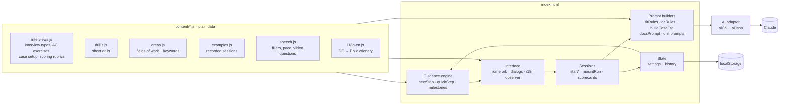
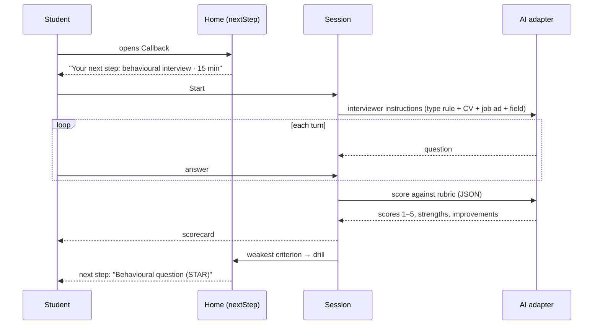

# Architecture

Callback is a static web app: one HTML page, six content files, no framework and no build step. Everything runs in the browser. The only external dependency is the AI model, and it sits behind a single function.

## Overview



## The parts

| Part | Where | What it does |
|---|---|---|
| **Content** | `content/*.js` | All domain knowledge as data: interview types with the instructions the AI follows, assessment centre exercises, scoring rubrics, drills, fields of work, example sessions and the English dictionary. |
| **Guidance engine** | `nextStep()`, `quickStep()`, `milestones()` | Decides the one thing the home screen shows. It reads the saved state (CV uploaded? goal set? documents checked? weakest criterion?) and the interview date, and returns a step such as `fit:fach` or `drill:star`. |
| **Field detection** | `detectArea()`, `aiArea()` | Scores the role title (strongest signal), job ad and company against the keywords in `areas.js`. The field steers question choice, case industry and which drills are suggested. Falls back to a quick AI guess, and the user can override it. |
| **Prompt builders** | `fitRules()`, `acRules()`, `buildCaseCfg()`, `docsPrompt()`, `drillGenPrompt()` | Combine content, the user's CV, the job ad and the field into instructions for the model. |
| **Sessions** | `startFit()`, `startAc()`, `startCase()`, `startDocs()`, `startDrill()` | Run a conversation turn by turn, then request a structured scorecard (JSON) and render it. A weak criterion maps to a drill via `CRIT_DRILL`, which closes the loop back to the guidance engine. |
| **Video interview** | `Video` | Camera and microphone via `getUserMedia`, timed prep and answer, local recording with `MediaRecorder` (blob URLs, never uploaded), transcript from the browser's speech recognition. Rated by the AI from the transcript, or by the user after watching. Falls back to audio only, then to written answers. |
| **Answer modes** | `settings.mode`, `Cam` | Every interview, AC exercise and case runs written, spoken (`cfg.oral`) or video (`cfg.video`). In video mode `Cam` keeps one camera stream for the session and records each spoken answer as a clip (memory only) while `Body` measures it. Inside Claude the camera is blocked, so video falls back to spoken and is marked work in progress. |
| **Body language** | `Body` | MediaPipe face landmarks from `vendor/mediapipe`, loaded only when the camera is on, sampled five times a second: face in frame, eye contact (head pose plus gaze), head movement, framing, light. Estimates, never stored as images. |
| **Self-assessment** | `Self`, `selfCompareHTML()` | Before the AI scorecard the user rates the same rubric; the scorecard shows both and the average gap. |
| **Speech analysis** | `speechStats()`, `speechSummary()` | Words per minute and filler words for answers given by microphone, per answer and per session. Word lists and pace limits in `speech.js`. |
| **Progress** | `progressData()` | Scores per session in order and each criterion's change from the first to the latest sessions, per practice type. |
| **Tester feedback** | `Feedback` | Asks "was this helpful?" after the 1st, 4th and 10th exercise; answers go to the owner's usage view. |
| **AI adapter** | `aiCall()`, `aiJson()` | The only place that talks to a model. Adds the interface language to every request. |
| **Own server** | `Server`, `server/server.mjs` | Outside Claude the app calls `api/health`; if a server answers, `aiCall()` streams through `api/sample` and `Track` stores usage via `api/usage`. The server maps the app's quick/default/complex tiers to effort low/medium/high on one model (default `claude-opus-5-5`, so prompt caching holds across a session), enables server-side refusal fallback, checks an optional tester access code, limits requests per IP and per day, and serves only the public files. |
| **State** | `settings`, `Store` | Settings and finished sessions live in `localStorage`. Inside Claude, preferences and history can sync to the artifact database. |
| **i18n** | `trCore()`, `MutationObserver` | The interface is written in German. When English is on, an observer translates every new text node and attribute from `i18n-en.js`, so new screens are translated without extra code. Model output follows the interface language through the adapter. |
| **Analytics** | `Track` | Inside Claude only: a pseudonymous count of active days, exercise types and scores plus tester feedback, visible to the owner, including the average improvement per person. Never answers or documents. The public demo records nothing. |

## A session, step by step



## Extending it

**Add an interview type.** Add one entry to `FIT_ARTS` in `content/interviews.js`:

```js
bank:{label:'Bankinterview',short:'Markets, valuation, motivation',crit:'fach',
  rule:'Interview for a graduate role at a bank. Ask about markets, valuation basics and why banking. ...'},
```

It shows up in the setup screen, the interviewer follows `rule`, and the `fach` rubric scores it. Reference it from a goal in `TRACKS` (`sims:['fit:bank']`) and the guidance engine starts recommending it. `tests/content.test.mjs` checks that every reference resolves.

**Add a field of work.** One entry in `AREAS` with keywords. Detection, the editable field chip and industry-specific cases pick it up.

**Add a language.** Add a dictionary file like `i18n-en.js` and a flag button. The observer handles the rest.

**Use another model.** Set `CLAUDE_MODEL` for the server. To use a different backend entirely, only `Server.sample()` (the browser side) and `server/server.mjs` change; nothing else talks to the model.

## Tests

`npm test` runs three suites, also on every push via GitHub Actions:

- `tests/content.test.mjs` checks the data: every goal points to interview types that exist, rubrics have unique criteria, every weak criterion maps to an existing drill, keywords are lower case, both example languages match.
- `tests/e2e.test.mjs` serves the folder over HTTP like GitHub Pages and opens it in Chromium (with a fake camera): no errors and no third-party requests, the guidance engine walks the journey in the right order, field detection, English switch, demo replay, video interview with recording and the written fallback, speech analysis, a full interview in video mode with recording, speech and body analysis and self-assessment, the body language maths, progress per criterion, tester feedback, phone layout in light and dark, the theme choice persists.
- `tests/server.test.mjs` starts the server with `MOCK_AI=1` (no key, no costs): access code, rate limit, malformed and oversized requests, the usage store, and that server code and configuration are never served.
- A guard test fails if two scripts define the same top-level name, since classic scripts silently replace each other's functions.

## Deliberate choices

- **No build step.** The page runs from disk, on GitHub Pages and as a Claude artifact unchanged. The trade-off is one large `index.html`; the content split is the first step towards modules.
- **Data over code.** Interview knowledge changes far more often than logic, so it lives in data files that non-developers can edit.
- **Camera inside Claude.** Claude artifacts cannot open the camera or microphone, so there the video interview and speech analysis fall back to written answers and device dictation. Both work fully in the public demo.
- **Privacy by default.** No accounts, no server, no third-party requests from the page itself. The CV is read locally; email addresses, phone numbers and links are stripped before the text reaches the model, and the model is told to leave out address and date of birth.
