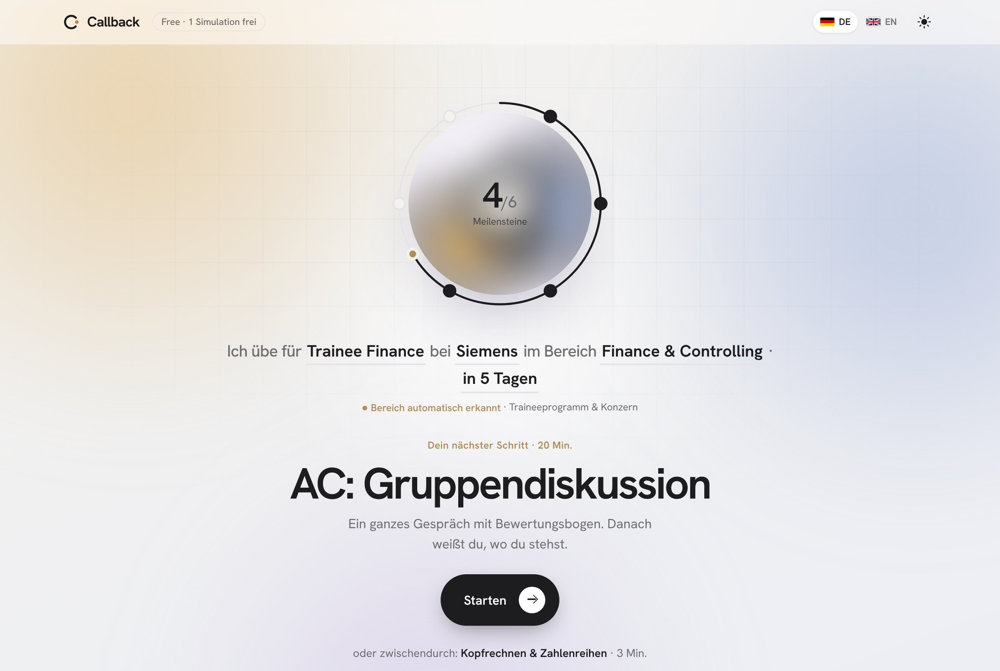
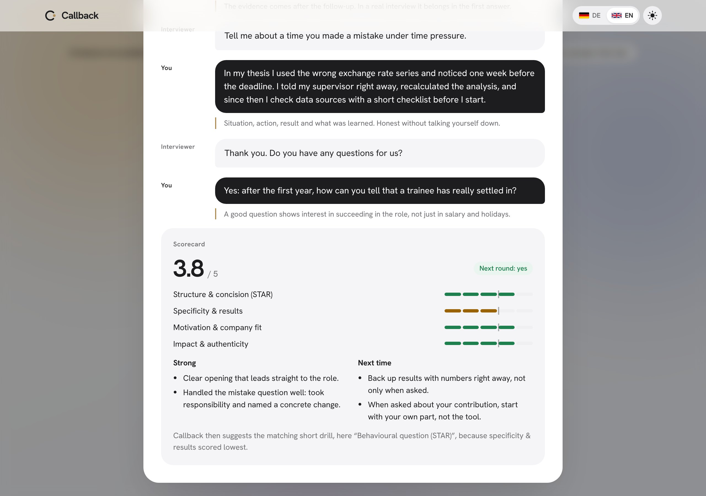
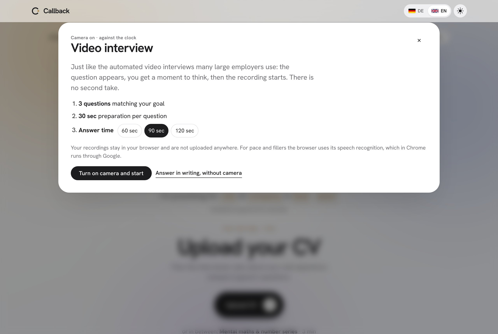
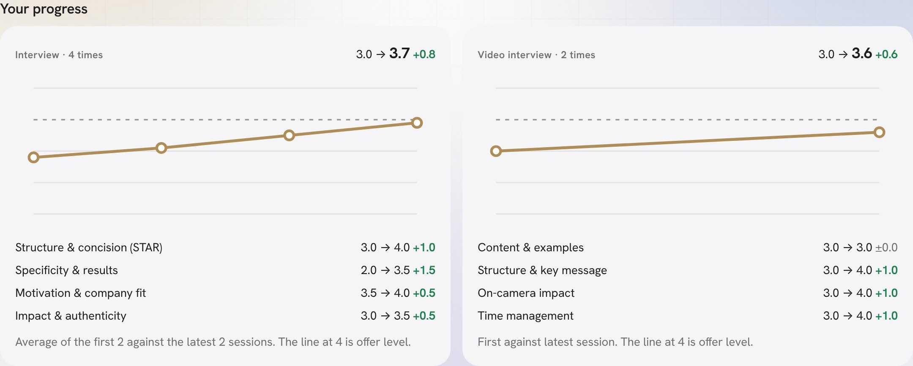
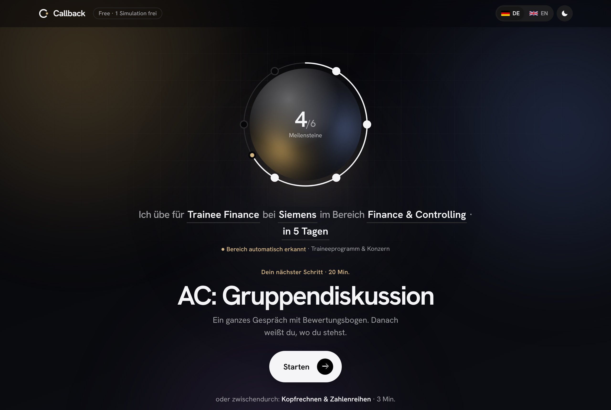
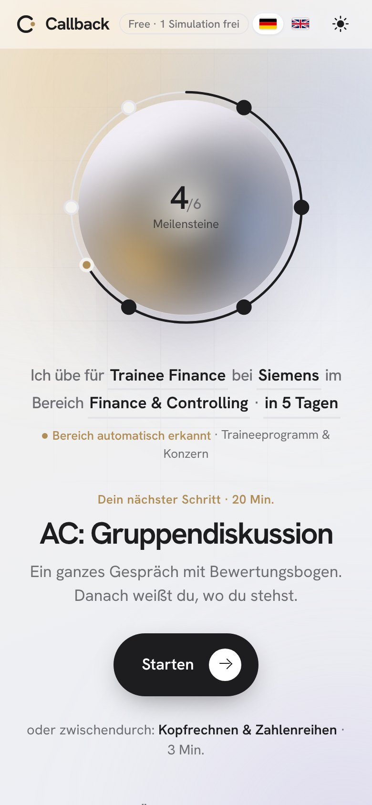
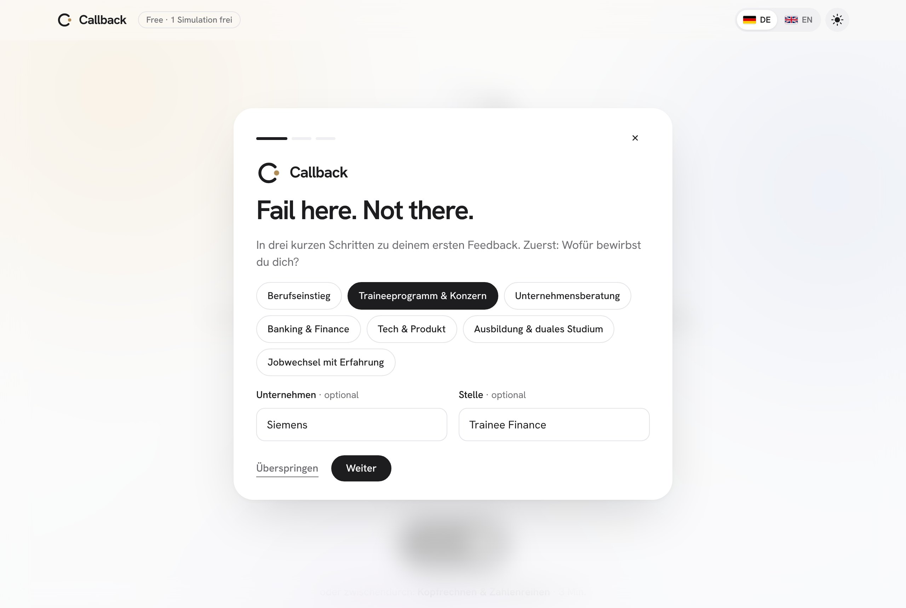

# Callback

[](https://github.com/claussec/callback-interview-coach/actions/workflows/test.yml)

**Fail here. Not there.**

Callback is an AI-powered interview coach for students and graduates. You rehearse job interviews, assessment centres and case interviews with an AI and get structured feedback before it counts in the real conversation.

> **Status:** Prototype. A personal project to make a product idea and its business model tangible.

**Demo:** https://claussec.github.io/callback-interview-coach/ · click **Watch an example interview** to see a full session replayed with its scorecard.



## The idea

There is no shortage of application advice. What is missing is a place where you are allowed to make mistakes before they cost you anything. Callback guides you step by step: instead of menus and tabs, the home screen only ever shows the one next step that helps your application most right now.

## Features

- **Guided start:** One sentence describes your goal ("I'm practising for Trainee Finance at Siemens …"). The field is detected automatically from the role and job ad and can be edited.
- **Interview simulation:** The AI plays the recruiter or hiring manager and asks questions based on your CV and the role.
- **Assessment centre:** Group discussion, role plays, presentation and in-tray exercise, scored like real assessors would.
- **Case interviews** for consulting and strategy roles.
- **Document check:** Your CV against the job ad, which also produces the questions you are most likely to get.
- **Video interview training:** Camera on, 30 seconds to think, then the answer is recorded against the clock, like the one-way video interviews many large employers use. Watch yourself back; recordings never leave the browser.
- **Speech analysis:** For spoken answers, pace in words per minute and filler words ("um", "like", "äh", "halt" …), per answer and per session.
- **Short drills and tests:** Self-introduction, questions for the interviewer, mental maths and number series.
- **Cheat sheet** for the day of the interview.
- **Progress:** six milestones on the ring around the animated orb, and a chart per practice type showing how each criterion changed from the first to the latest sessions.
- **Tester feedback:** a short "was this helpful?" after the 1st, 4th and 10th exercise, collected anonymously for the owner.
- German and English, light and dark mode, mobile and desktop.

**Demo replay** – the public demo has no AI, so it plays back a recorded interview and its scorecard:



| Video interview | Progress per criterion |
|---|---|
|  |  |

| Dark mode | Mobile | Onboarding |
|---|---|---|
|  |  |  |

## How it works

- **No build step, no framework:** `index.html` plus six content files. Runs from disk, on GitHub Pages and as a Claude artifact unchanged.
- **Data over code:** interview types, assessment centre exercises, scoring rubrics, drills and fields of work live in [`content/`](content). Adding an interview type is one entry, not a code change.
- **Guidance engine:** the home screen asks one function, `nextStep()`, what matters most right now, based on progress, weakest criterion and days until the interview.
- **One AI seam:** every model call goes through `aiCall()` / `aiJson()`. The AI features use the Claude Artifacts runtime and **do not run in the GitHub demo**, which shows a recorded session instead. Swapping in your own backend means changing those two functions.
- **Tested:** content consistency and end-to-end browser tests run on every push.

More in [ARCHITECTURE.md](ARCHITECTURE.md), ideas in [ROADMAP.md](ROADMAP.md), setup in [CONTRIBUTING.md](CONTRIBUTING.md).

```
index.html            app: guidance engine, prompt builders, sessions, interface
content/
  interviews.js       interview types, AC exercises, case setup, scoring rubrics
  drills.js           short drills
  areas.js            fields of work and detection keywords
  examples.js         recorded example sessions (demo mode)
  speech.js           filler words, pace limits, video interview questions
  i18n-en.js          German → English dictionary
tests/                content checks (Node) and browser tests (Playwright)
fonts/                self-hosted fonts, no third-party requests
```

## Privacy

- **Public demo (GitHub Pages):** no AI calls, no tracking. Video recordings stay in the browser. Speech recognition is the browser's own; in Chrome it sends audio to Google, so written answers are always offered.
- **Claude version:** AI features send the user's input to Claude (Anthropic) through the user's own Claude access. A pseudonymous usage count (days, exercise types, scores; no answers or documents) helps improve the prototype.

## Business model (concept)

Freemium: short drills and tests free, full simulations limited per week, a time-limited Application Pass, and a licence for career services. Switched off in the prototype; see [ROADMAP.md](ROADMAP.md).

## How it was built

The idea, product concept, user flow and design direction are mine. I developed the code together with the AI Claude (Anthropic): I described, decided and tested, and Claude wrote most of the code.

## License

[MIT](LICENSE) © 2026 Clemens Claussen
